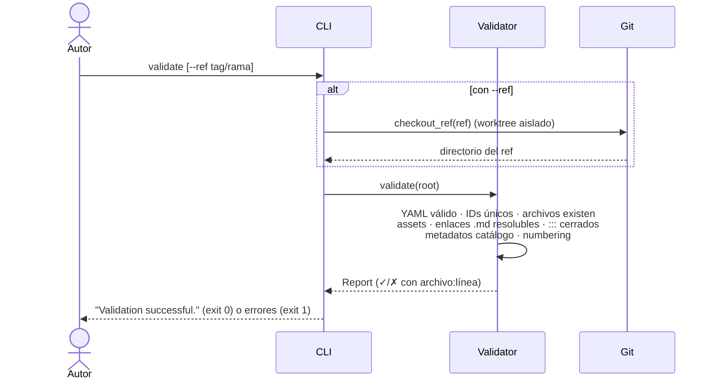
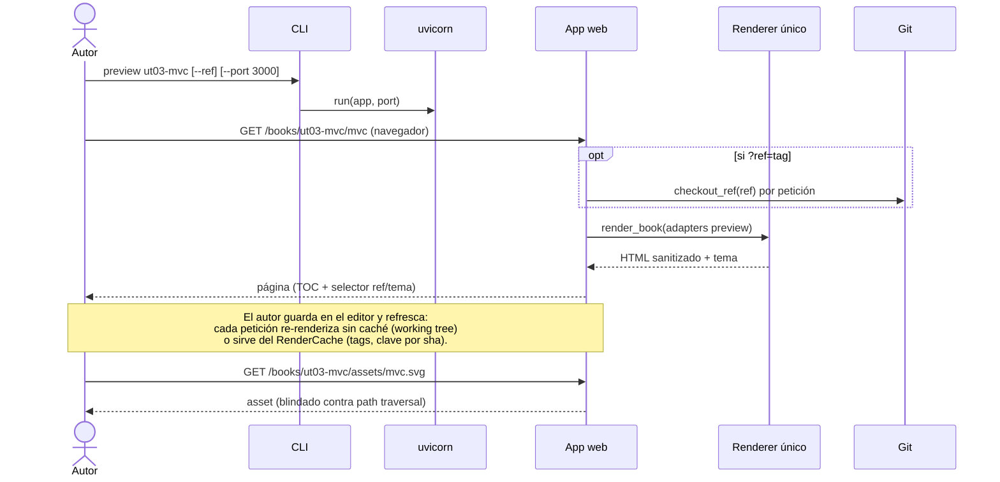
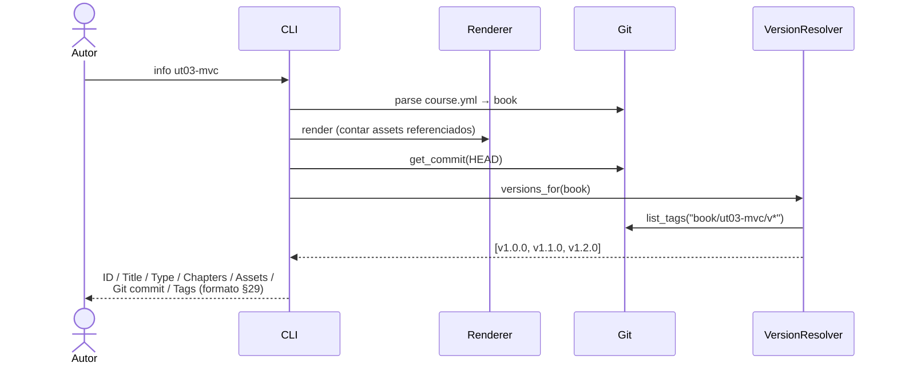
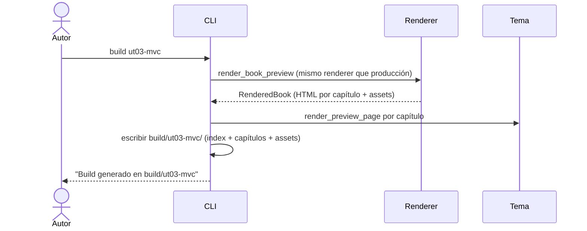
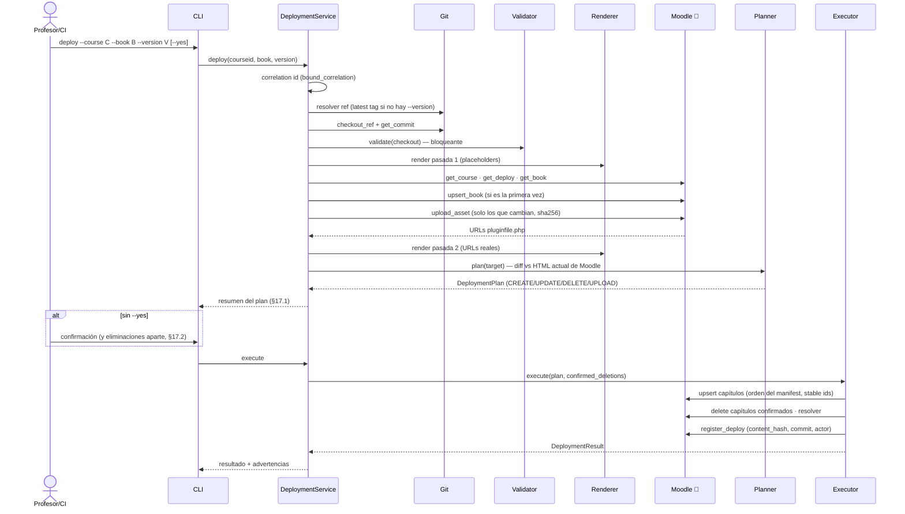
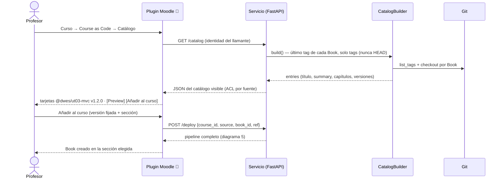
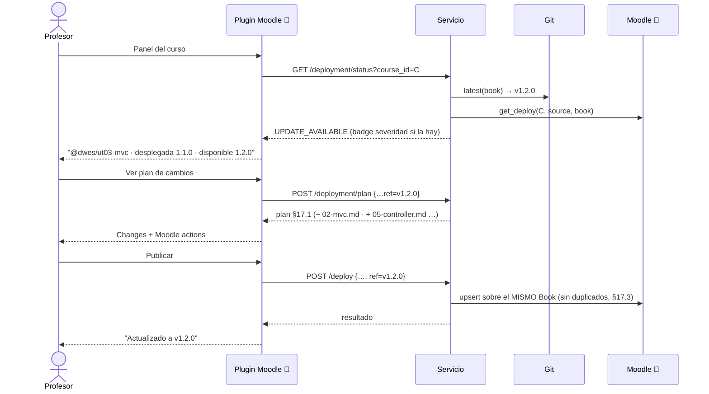
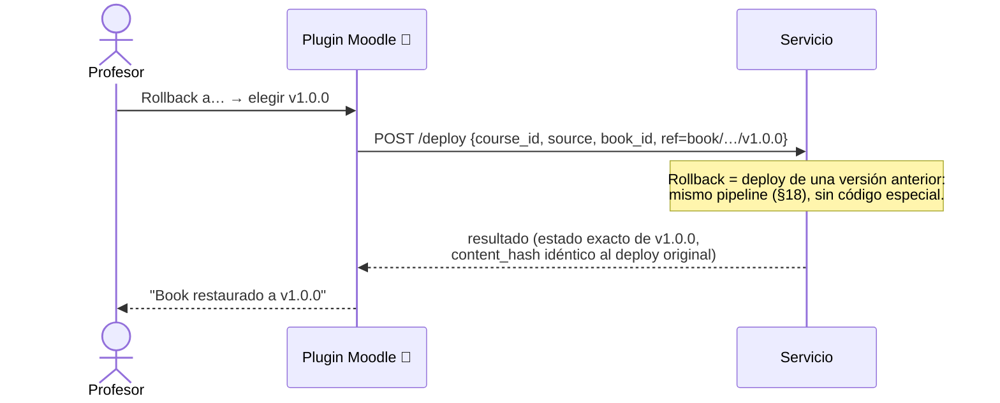
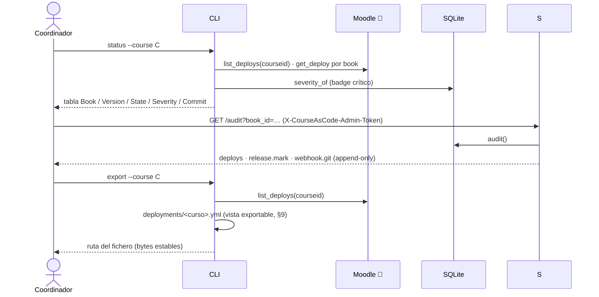

# Diagramas de secuencia — Acciones del usuario

Un diagrama por cada acción que realizan los usuarios del sistema (autor,
profesor, coordinador) sobre el engine, con el detalle interno relevante.
Formato Mermaid (`sequenceDiagram`). Complementa los diagramas de arquitectura
de [Diagramas de secuencia — Moodle Course as Code](Diagramas%20de%20secuencia%20—%20Moodle%20Course%20as%20Code.md)
y la especificación (§17 pipeline de publicación).

Participantes habituales: **CLI** (`courseascode`), **Servicio** (app FastAPI),
**Pipeline** (`DeploymentService` = validación + render + Planner + Executor),
**Git**, **Moodle** (web services del plugin `local_courseascode` 🔌) y
**BD** (SQLite de releases/auditoría).

## 1. Autor — validar contenido (`courseascode validate [--ref]`)



## 2. Autor — previsualizar (`courseascode preview <book> [--ref]`)



## 3. Autor — consultar metadata (`courseascode info <book>`)



## 4. Autor — render a disco (`courseascode build <book>`)



## 5. Coordinador/CI — publicar una versión (`courseascode deploy`)



## 6. Error a mitad de deploy y recuperación (ENG-102)

```mermaid
sequenceDiagram
    actor P as Profesor/CI
    participant S as DeploymentService
    participant E as Executor
    participant M as Moodle 🔌
    S->>E: execute(plan)
    E->>M: upsert capítulos …
    M--xE: MoodleError (p. ej. timeout)
    E->>M: register_deploy(status="error")
    E--xS: DeploymentExecutionError accionable
    S-->>P: "interrumpido al aplicar UPDATE sobre 'Model': …<br/>Sugerencia: relanza el mismo deploy"
    Note over P,M: El estado del Book es ERROR (§19).<br/>El pipeline es idempotente: no duplica lo ya desplegado.
    P->>S: deploy (idéntico, de nuevo)
    S->>E: execute(plan)
    E->>M: continúa donde falló → register_deploy(ok)
    E-->>S: DeploymentResult(success)
    S-->>P: desplegado; estado UP_TO_DATE
```

## 7. Profesor — importar un Book desde el catálogo (Moodle 🔌 → servicio)



## 8. Profesor — actualizar a una versión nueva (UPDATE_AVAILABLE → publicar)



## 9. Profesor — rollback a una versión anterior



## 10. Coordinador — marcar severidad / recall (hotfix crítico §11.1)

```mermaid
sequenceDiagram
    actor C as Coordinador
    participant CLI
    participant DB as SQLite (releases + auditoría)
    participant S as Servicio
    participant M as Moodle 🔌
    C->>CLI: release mark book/ut03-mvc/v1.3.0<br/>--severity critical --fixed-in v1.3.1 --reason "…"
    CLI->>CLI: exige COURSEASCODE_ADMIN_TOKEN (rol coordinador)
    CLI->>DB: mark (upsert por ref: severity, recall, fixed_in, reason)
    DB->>DB: AuditEvent "release.mark" (quién/cuándo/qué)
    CLI-->>C: "book/ut03-mvc/v1.3.0 marcado: critical"
    C->>S: (el servicio lo consulta al planear/estado)
    S->>DB: severity_of / is_recalled
    Note over C,M: DoD: status muestra badge crítico;<br/>deploy de la RECALLED falla (salvo --force, con warning);<br/>GET /releases/affected lista cursos + profesores<br/>(la notificación la envía el plugin 🔌).
```

## 11. Sistema — webhook de Git (push/tag → recálculo)

```mermaid
sequenceDiagram
    participant GP as Plataforma Git
    participant S as Servicio
    participant DB as SQLite
    participant C as RenderCache
    GP->>S: POST /hooks/git (body: push/merge/tag)
    S->>S: verifica firma HMAC-SHA256<br/>(X-CourseAsCode-Signature: sha256=<hex>)
    alt firma inválida
        S-->>GP: 401
    else firma válida
        S->>DB: AuditEvent "webhook.git"
        S->>C: clear() (invalidación conservadora)
        S-->>GP: 200 {evento procesado}
        Note over S: Las cachés de checkouts/renders se recalculan<br/>bajo demanda; hoy no-op más allá de la invalidación<br/>(recálculo proactivo: post-Beta).
    end
```

## 12. Coordinador — auditoría y exportación



---

Notas transversales:

- **Renderer único (principio 5):** los diagramas 2, 4, 5 y 7–9 usan el mismo
  `render_book`; solo cambian los adapters de enlaces/assets (preview local vs
  Moodle `pluginfile.php`).
- **Idempotencia (§17.3):** todo camino de escritura clave por stable ids
  (capítulos) y por `(courseid, source, content_id)` (books y registros).
- Los pasos marcados 🔌 (plugin) son la pista paralela: el engine ya consume su
  contrato (`moodle/functions.py`) y lo simula con `FakeMoodleProvider` en CI.
